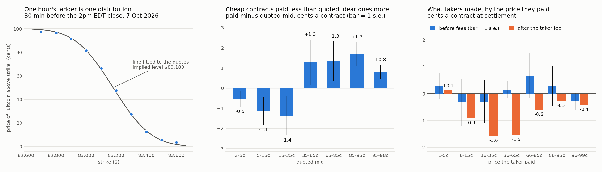

# Kalshi's hourly Bitcoin ladder: what a contract is worth, who gets paid, and the same question on Polymarket

Every hour Kalshi lists a ladder of binary contracts, "Bitcoin above K at the top of the hour", with strikes $100
apart. This repository takes that ladder apart over the two months the public API still serves, 8 August to
7 October 2026: 1,432 hourly events and 2.3 billion contracts. Everything here uses public data and no account.

## What I found

1. **The fee is the money, and it comes from takers.** On a sample of every fifth hourly event
   (287 events, 5.4 million trade prints, 476 million contracts) takers made +0.07c a contract at
   settlement before fees (s.e. 0.16) and paid 1.03c in fees, so they ended 0.96c a contract down. The quote
   moved 0.08c in the taker's favour over the next one to two minutes (s.e. 0.03). Makers pay no fee
   on this series, but they ended level with takers, so the half-cent spread they show is not their profit: it
   goes back to flow that is faster than their quote. Scaled to the whole series, taker fees were about $24M in two months.
2. **The contract is an option on an average.** It settles on the mean of the sixty one-second prints of the CF
   Benchmarks index before the hour. For a diffusion, the variance of that mean seen `tau` seconds before the
   close is the variance of `tau - 39.5` seconds of path, so the contract's clock stops about 40 seconds early.
3. **A ladder is one distribution, and its probit is a straight line.** A least-squares line through the probit of
   the quoted mids against log strike gives the market's implied settlement level and implied volatility from
   Kalshi quotes alone. Across 3,800 fitted ladders implied variance was 16% below realized (ratio 0.84, 95%
   interval 0.80 to 0.88, and 0.83 against the squared move to settlement), while the quotes were close to
   calibrated (probit coefficient 1.06, s.e. 0.02). Both hold because the hour's move is fat-tailed: measured in
   implied standard deviations it has kurtosis 9.4, 44% of moves inside a half (a normal gives 38%) and 1.6%
   beyond three (a normal gives 0.27%).
4. **A spot-only model has nothing to add, and taking loses.** I fixed the model, a taker rule (trade when the
   model disagrees with the quote by the fee plus 2c) and a three-week final window before looking at outcomes.
   On the final window, run once, the model's disagreement with the market carried no information (coefficient
   -0.03, t -0.4) and the rule lost 2.8c a contract after fees (t -4.6) on 7,976 orders.
5. **The same strike on Polymarket is a different contract.** Polymarket's noon ladder resolves on the close of
   the Binance BTC/USDT one-minute candle labelled 12:00 ET; Kalshi's noon ladder resolves on the index average
   over the minute before 12:00. Binance ran a median $23 above the index. At the same strike and minute
   Polymarket was 3.0c above Kalshi on average, and 0.6c (s.e. 0.8) once the Kalshi quote is repriced onto
   Polymarket's fixing with the ladder's own implied volatility. On 26 August 2026 the $78,000 strike paid on
   Polymarket (Binance closed at 78,028.02) and not on Kalshi (index average 77,993.34). With Kalshi's $100
   spacing, at least one strike would have resolved the other way on 22 of 61 days.

All tables are in [results/RESULTS.md](results/RESULTS.md); the plan, written before any outcome was analysed,
and the log of what changed afterwards are in [PLAN.md](PLAN.md).

## What I would do with it

- **Not take.** The taker fee is `0.07 * p * (1 - p)` a contract, 1.75c at 50c, against a mean half-spread of
  0.55c. A taker needs to be right by more than three half-spreads before the trade pays. The closest a taker
  gets is buying 85c to 95c favourites, which paid 1.7c more than quoted (s.e. 0.6) and leaves about 0.6c after
  the half-spread and fee, not distinguishable from zero.
- **Make, and be fast about it.** Makers pay no fee, cheap contracts are slightly overpriced and dear ones slightly
  underpriced, and the ladder itself hands over an implied level and volatility to quote around. The ledger says
  the risk is being picked off, so the quote has to move with spot and skew with inventory.
- **Treat cross-venue pairs as basis trades.** A Yes on one venue against a No on the other is long one fixing
  and short another. Price the basis and the extra minute of variance first; what is left after that is the trade.

## The two formulas

Settlement average. With `n = 60` prints `h = 1` second apart and a variance rate `s2` per second, the mean of the
`m` prints still to come has variance `s2 * h * m (m+1) (2m+1) / (6 n^2)`. Before the last minute all sixty are
ahead and the path first runs `tau - 60` seconds, so

    Var = s2 * (tau - 60 + 60 * 61 * 121 / 21600) = s2 * (tau - 39.5)
    fair value = Phi((ln(S / K) - Var / 2) / sqrt(Var))

Ladder. For strikes `K_i` with mids `p_i` between 5c and 95c, regress `Phi^-1(p_i)` on `ln K_i`. With slope `b`
and intercept `a`, the implied standard deviation to settlement is `s = -1 / b` and the implied settlement level is
`exp(a * s + s^2 / 2)`.

`tests/` checks the first formula against simulated one-second paths, the fair value against simulated settlement
averages, the ladder fit on a synthetic ladder, the fee schedule, and the sign conventions of the backtest.

## Run it

    pip install -r requirements.txt
    python -m pytest -q
    python -m kfv.download markets && python -m kfv.download spot      # about 10 minutes
    python -m kfv.download candles                                     # about 20 minutes
    python -m kfv.download trades                                      # about 50 minutes at 5 requests a second
    python -m kfv.cross_venue download
    python -m kfv.study dev && python -m kfv.study final
    python -m kfv.study implied && python -m kfv.study ledger && python -m kfv.cross_venue
    python -m kfv.report && python -m kfv.figure

| file | what it does |
|---|---|
| `kfv/api.py` | Kalshi markets, one-minute bid/ask candles and trade prints; Coinbase one-minute spot |
| `kfv/model.py` | variance of the settlement average, fair value, ladder fit, fee schedule |
| `kfv/study.py` | the ledger, implied against realized, the information test and the taker rule |
| `kfv/cross_venue.py` | Polymarket (Gamma and CLOB APIs) and Binance against Kalshi at noon Eastern |
| `kfv/report.py`, `kfv/figure.py` | `results/RESULTS.md` and `results/summary.png` from `results/*.json` |
| `kfv/account.py`, `kfv/maker.py` | signed client for your own account, and a tool that rests small post-only bids on the ladder |

## Resting a small order

`kfv/maker.py` acts on findings 1 and 3: it only ever rests a bid, never takes, and it buys the side priced 85c to
95c on at most one strike below spot (Yes) and one above (No). Each order is post-only, at most 20 contracts, and
cancels itself five minutes before the close; a run spends at most $25 of premium.

    python -m kfv.maker quote                 # prints the orders; public data only, nothing is sent
    export KALSHI_KEY_ID=...                  # credentials stay in your environment, not in the repository
    export KALSHI_KEY_FILE=~/path/to/private-key-file
    python -m kfv.maker fund --dollars 20 --live    # API orders need cash on the crypto exchange shard first
    python -m kfv.maker quote --live          # places them
    python -m kfv.maker status                # balance, resting orders, positions, fills
    python -m kfv.maker cancel --live

## Scope

Quotes are one-minute closing bid and ask, not the full book, and spot is Coinbase BTC-USD, which sat a median
$5 below the level the ladder implies. The ledger measures takers against makers at settlement and over two
minutes; it does not see a maker's hedging or inventory cost. The cross-venue comparison covers 61 noon fixings
and uses Polymarket's minute price history, which can be up to two minutes away from the Kalshi quote.
